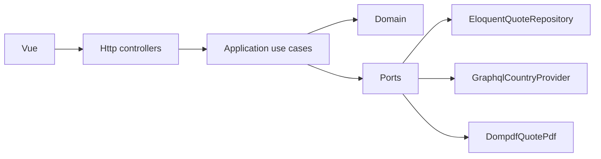

# Gestión Segura — Cotizador de seguro de viaje

Aplicación para cotizar y contratar un seguro de viaje. El cliente ingresa sus datos y el viaje, recibe la prima, descarga la cotización en PDF y puede confirmar la contratación. Las cotizaciones y los contratos se consultan en un listado con filtros y paginación.

La prima es **USD 3 por día**, más un recargo según la región del destino. No hay pasarela de pago: al contratar, el registro pasa de **Cotizado** a **Contratado**.

## Requisitos

- PHP 8.3 con `mbstring`, `xml`, `curl`, `zip`, `pdo_mysql`, `bcmath`, `intl` y `gd`
- Composer 2
- Node.js 22 y npm
- MySQL 8

## Instalación

```bash
git clone <repositorio> seguro-viaje
cd seguro-viaje
composer install
cp .env.example .env
php artisan key:generate
```

Crea la base de datos y el usuario. El `.env.example` usa estos valores locales, que no son credenciales de producción:

```sql
CREATE DATABASE gestion_segura CHARACTER SET utf8mb4 COLLATE utf8mb4_unicode_ci;
CREATE USER 'seguro'@'localhost' IDENTIFIED BY 'seguro';
GRANT ALL PRIVILEGES ON gestion_segura.* TO 'seguro'@'localhost';
```

Ajusta `DB_*` en `.env` si tu MySQL usa otro usuario. Después:

```bash
php artisan migrate --seed
npm ci
npm run build
php artisan serve --host=127.0.0.1 --port=43123
```

Abre [http://127.0.0.1:43123](http://127.0.0.1:43123).

`migrate --seed` carga el usuario de demostración, el catálogo de países y doce cotizaciones de ejemplo. Para rehacer los datos: `php artisan migrate:fresh --seed`.

El listado interno usa esta cuenta, creada por el seeder:

- Correo: `admin@gestionsegura.test`
- Contraseña: `password`

Es una clave de demostración, no una credencial de producción. La cotización, el PDF y la contratación siguen siendo públicos.

Durante el desarrollo del frontend se puede usar `npm run dev` en otra terminal. Laravel toma los assets de Vite mientras ese proceso está activo.

## Docker

```bash
docker compose up --build
docker compose exec app php artisan db:seed
```

La aplicación queda en [http://127.0.0.1:43123](http://127.0.0.1:43123) y MySQL del contenedor en el puerto `33061`. La contraseña local del contenedor también es `seguro`.

## Pruebas

```bash
php artisan test
```

Pest ejecuta las pruebas sobre SQLite en memoria. El esquema no usa tipos exclusivos de MySQL, así que la suite no necesita un servidor de base de datos. La aplicación en sí corre sobre MySQL. El cliente de países se prueba con `Http::fake()`: respuesta GraphQL útil, tiempo de espera, HTTP de error, errores GraphQL y un cuerpo que no es JSON. También hay pruebas del login, del listado privado y del log JSON. GitHub Actions ejecuta `php artisan test` y `npm run build` (incluye `vue-tsc`).

## Cómo se usa

1. **Cotizar.** Nombres, apellidos, identificación, correo, nacimiento, país, salida y regreso.
2. La pantalla siguiente muestra días, tarifa base, porcentaje, recargo y total.
3. **Descargar PDF** genera el documento de esa cotización.
4. **Contratar seguro** guarda la fecha de contratación y cambia el estado. No se puede contratar dos veces.
5. **Contrataciones** pide iniciar sesión. Lista cliente, identificación, destino, fechas, valor, estado y fecha de creación. Se puede buscar, filtrar por estado y por rango de salida, y paginar.

## Arquitectura

Es una arquitectura hexagonal ligera. El dominio no conoce Laravel: la prima, el periodo del viaje y el estado de la cotización se pueden probar con Pest sin levantar el framework. El caso de uso depende de puertos (`QuoteRepository`, `CountryProvider`, `PdfGenerator`), así que cambiar el proveedor de países o el generador de PDF no toca la regla de negocio. HTTP es solo un adaptador de entrada.



```
app/Domain            PHP puro: Quote, TripPeriod, Money, PremiumCalculator, RegionSurchargePolicy, QuoteStatus.
app/Application       Casos de uso y puertos.
app/Infrastructure    Adaptadores: Eloquent, GraphQL con caché y respaldo, Dompdf, log JSON.
app/Http              Form Requests, controladores y el presentador JSON.
resources/js          Vue 3 + TypeScript, Vue Router y Pinia. Sin cálculo de prima.
```

Los puertos se enlazan en `AppServiceProvider`. El controlador no calcula ni consulta Eloquent: arma el comando, llama al caso de uso y presenta el resultado. Vue valida el formulario para responder al instante, pero el precio sale del dominio.

Cada cotización guarda su propio asegurado (`insureds` 1—N `quotes`). Es una foto del momento: una cotización posterior no reescribe el nombre ni la prima de la anterior. En la cotización también quedan el código y el nombre del destino, la región tarifaria, los días, la tarifa diaria aplicada, la base, el porcentaje, el recargo y el total. Si mañana la tarifa deja de ser USD 3, las cotizaciones viejas no cambian.

Los montos se guardan en centavos. Con USD 3.00 y recargos de 0, 15, 20 y 25 por ciento la división es exacta; de todos modos el redondeo es half-up al centavo.

Los días incluyen la salida y el regreso. Del 1 al 10 son 10 días: `10 × 3 = 30`. España (Europa, 20 %) queda en `30 + 6 = 36`.

## Países

La fuente principal es el GraphQL público de [countries.trevorblades.com](https://countries.trevorblades.com/). No pide token. Una consulta devuelve código ISO, nombre, emoji de la bandera y continente. Lo verifiqué en vivo: HTTP 200, 250 países, y el continente ya separa North America de South America, que es justo la distinción de la tarifa.

No usé REST Countries como fuente principal. La v3 de [restcountries.com](https://restcountries.com/) responde que esa versión fue retirada. La v5 (`https://api.restcountries.com/countries/v5`) exige `Authorization: Bearer`, y la key de demostración no entrega el catálogo real. [countriesnow.space](https://countriesnow.space/) responde sin key, pero sus listas no traen la región que necesita el recargo.

El cliente hace un POST con timeout de 8 segundos y un reintento si se cae la conexión. Acepta `data.countries`. Rechaza `errors` de GraphQL, `success: false`, un cuerpo que no es JSON, un HTTP de error y una lista sin países útiles. Si una fila no tiene código ISO, se salta. Si el cuerpo se pareciera al de REST Countries v3 o v5, el normalizador también lo lee, para no romper si el upstream cambia de forma conocida.

Cuando la lectura sirve, los países se guardan en la tabla `countries` y en caché 12 horas. Si falla, se usa esa tabla. Si está vacía, se usa `database/data/countries.json`. El fallo se cachea 10 minutos para volver a intentar la API pronto.

La API devuelve el nombre en inglés. Si el código existe en el archivo local, se muestra el nombre en español. La región y la bandera siguen saliendo de la API.

| Continente o subregión | Tarifa | Recargo |
| --- | --- | --- |
| South America | Sudamérica | 0 % |
| North America, Northern America, Central America, Caribbean | Norteamérica | 15 % |
| Europe | Europa | 20 % |
| Africa | África | 20 % |
| Asia | Asia | 25 % |
| Oceania | Oceanía | 25 % |
| Antártida u otra región desconocida | Otras regiones | 25 % |

Centroamérica y el Caribe no tienen fila propia en la tabla del enunciado. Se tarifican con Norteamérica. Antártida usa el recargo más alto, para no cotizar una región desconocida a 0 %.

El archivo de respaldo sale del conjunto público de REST Countries (nombres en español, código ISO, región y subregión) y queda atribuido en el propio JSON.

## Validaciones

En el formulario y en el `StoreQuoteRequest`:

- Nombres y apellidos obligatorios, de 2 a 80 caracteres, solo letras (se aceptan tildes, espacios, apóstrofos y guiones).
- Identificación de 5 a 20 letras o números. Sirve para cédula o pasaporte.
- Correo con formato válido.
- Nacimiento en el pasado. Entre 18 y 85 años en la fecha de salida.
- Destino con código ISO existente en el catálogo.
- Salida hoy o después. Regreso igual o posterior a la salida. Máximo 365 días.

## Marca

Los colores salen del sitio público [gestionsegura.com.ec](https://gestionsegura.com.ec/), de las variables del tema Insur:

- Primario `#fcb333` (`--insur-primary`), botones y acentos.
- Base `#233266` (`--insur-base`), paneles.
- Negro `#16243d` (`--insur-black`), cabecera y texto de botón.
- Fuente [DM Sans](https://fonts.google.com/specimen/DM+Sans), la que declara el tema (`insur-fonts`). No se copió el archivo del logo: el encabezado es un wordmark.

## Decisiones

- **Laravel 13, Vue 3 y MySQL 8.** Son el stack pedido, en las versiones estables actuales. PHP 8.3 alcanza; Pest 5 ya pide PHP 8.4, así que la suite usa Pest 4.
- **API JSON + SPA en TypeScript**, en lugar de Blade o Inertia, porque las pruebas de API y la pantalla consumen el mismo contrato. Pinia guarda la sesión, los países, la tarifa y las cotizaciones. Los componentes no recalculan la prima.
- **Sanctum con cookie de sesión** para el listado. Es el mismo estilo que Breeze, sin montar todo su scaffolding: la cotización pública no necesita cuenta y el listado sí.
- **Dompdf** para el PDF. No depende de un navegador y el documento usa los montos ya guardados.
- **Caché de archivo y sesión de archivo.** El catálogo no necesita Redis para esta escala.
- **Log JSON** en `storage/logs/structured.log`, con el evento y el contexto de la llamada externa y de la contratación.
- **Zona `America/Guayaquil`.** La fecha de contratación se muestra en la hora de la compañía.
- **SQLite solo en pruebas.** MySQL sigue siendo la base de la aplicación y de Docker.
- **Sin pasarela de pago.** El enunciado no la pide.

## Bonus y por qué están

- **Docker Compose.** `docker compose up --build` levanta PHP y MySQL, migra y sirve la SPA ya compilada. Así la prueba no depende de tener PHP instalado a mano.
- **TypeScript.** El frontend está tipado (`vue-tsc` corre antes de Vite) para que el contrato del API no se desvíe en silencio.
- **Pinia.** La sesión, el catálogo, la tarifa y el listado viven en stores. La vista solo pinta y valida el formulario.
- **Login del listado.** Sanctum con la sesión de Laravel. El cliente cotiza sin cuenta; quien consulta todas las pólizas entra con el usuario de demostración.
- **CI.** `.github/workflows/tests.yml` instala PHP y Node, corre Pest y compila el frontend.
- **Factories.** Asegurado, cotización, país y usuario. Las pruebas del listado y del login las usan en vez de insertar filas a mano.
- **Cobertura.** La tarifa, los días, la región, el normalizador, el API de países (con HTTP falso), la cotización, el PDF, el login y el log JSON tienen pruebas. No es cobertura ciega de cada línea.
- **Caché de la API.** 12 horas si respondió, 10 minutos si falló, y la tabla `countries` como copia durable.
- **Logs JSON.** Canal `json` con `JsonFormatter`. Cada llamada externa guarda URL, estado, duración y motivo. Crear o contratar una cotización guarda id, destino y centavos.
- **UI.** La misma paleta de la marca en escritorio y en 390 px: formulario, resultado, listado en tarjetas y pantalla de ingreso.

## Mejoras si esto pasara a producción

- Cuentas de clientes, distintas del usuario interno que ve el listado.
- Pasarela de pago y emisión real de la póliza, con el PDF firmado o numerado por un secuencial propio.
- Separar el cliente maestro de la foto guardada en cada cotización, y permitir varios viajeros por póliza.
- Editar la tarifa sin desplegar código, con vigencia, para no mezclar precios viejos y nuevos.
- Sincronizar países con un job programado, en vez de hacerlo en la primera lectura del request.
- Límites de tasa, idempotencia al contratar y una cola para el PDF.
- Más cobertura de extremo a extremo en el navegador y observabilidad sobre los fallbacks de la API.

## Qué quedó fuera

El flujo pedido está completo, incluidos los bonus de arriba. No hay cobro ni emisión de póliza: el enunciado no los pide.
